# Database

PostgreSQL 15+ (Neon) or 17 (embedded PGlite in development). All identifiers are
`snake_case`, every table has `created_at`, mutable tables have `updated_at` maintained
by the `set_updated_at()` trigger, and primary keys are UUIDs (`gen_random_uuid()`).

## 1. Entity relationship diagram

```mermaid
erDiagram
    USERS ||--o{ USER_ROLES : has
    ROLES ||--o{ USER_ROLES : grants
    USERS ||--o{ SESSIONS : opens
    USERS ||--o| STUDENT_PROFILES : "student record"
    USERS ||--o| TEACHER_PROFILES : "teacher record"
    STUDENT_PROFILES ||--o{ GUARDIAN_PROFILES : has
    STUDENT_PROFILES ||--o{ ENROLLMENTS : enrolled
    COURSES ||--o{ SUBJECTS_COURSES : includes
    SUBJECTS ||--o{ SUBJECTS_COURSES : "part of"
    COURSES ||--o{ BATCHES : runs
    BATCHES ||--o{ ENROLLMENTS : contains
    BATCHES ||--o{ BATCH_SUBJECTS : covers
    BATCHES ||--o{ BATCH_TEACHERS : staffed
    TEACHER_PROFILES ||--o{ BATCH_TEACHERS : teaches
    BATCHES ||--o{ BATCH_SCHEDULES : timetable
    BATCHES ||--o{ LESSONS : publishes
    STUDENT_PROFILES ||--o{ LESSON_PROGRESS : watches
    LESSONS ||--o{ LESSON_PROGRESS : tracked
    BATCHES ||--o{ STUDY_MATERIALS : stores
    BATCHES ||--o{ ASSIGNMENTS : sets
    ASSIGNMENTS ||--o{ ASSIGNMENT_SUBMISSIONS : receives
    STUDENT_PROFILES ||--o{ ASSIGNMENT_SUBMISSIONS : submits
    BATCHES ||--o{ ATTENDANCE : records
    STUDENT_PROFILES ||--o{ ATTENDANCE : marked
    BATCHES ||--o{ EXAMS : schedules
    EXAMS ||--o{ EXAM_QUESTIONS : contains
    EXAM_QUESTIONS ||--o{ EXAM_OPTIONS : offers
    EXAM_QUESTIONS ||--o| EXAM_ANSWER_KEYS : "protected key"
    EXAMS ||--o{ EXAM_ATTEMPTS : attempted
    STUDENT_PROFILES ||--o{ EXAM_ATTEMPTS : takes
    EXAM_ATTEMPTS ||--o{ EXAM_RESPONSES : saves
    EXAM_QUESTIONS ||--o{ EXAM_RESPONSES : answers
    EXAM_ATTEMPTS ||--o| EXAM_RESULTS : scores
    COURSES ||--o{ FEE_STRUCTURES : prices
    FEE_STRUCTURES ||--o{ STUDENT_FEES : assigned
    STUDENT_PROFILES ||--o{ STUDENT_FEES : owes
    STUDENT_FEES ||--o{ PAYMENTS : paid_by
    USERS ||--o{ ANNOUNCEMENTS : authors
    BATCHES ||--o{ ANNOUNCEMENTS : targets
    USERS ||--o{ NOTIFICATIONS : receives
    USERS ||--o{ AUDIT_LOGS : acts
```



`SUBJECTS_COURSES` is `course_subjects` in SQL (join table, semester metadata).

## 2. Tables

### Identity

| Table | Purpose | Key constraints |
| --- | --- | --- |
| `roles` | Reference list (`super_admin`, `admin`, `teacher`, `student`) | PK `code`; seeded by migration |
| `users` | One login identity for every person | unique `lower(email)`; status check; lockout counters |
| `user_roles` | Many-to-many roles | PK `(user_id, role_code)` |
| `sessions` | Server-side sessions | unique `token_hash`; partial index on active sessions |
| `audit_logs` | Append-only admin/auth trail | `actor_email` snapshot survives user deletion |

### Academics

| Table | Purpose | Notes |
| --- | --- | --- |
| `courses` | Programmes (JEE 2027, NEET 2027) | unique `lower(code)`, duration 1–72 months |
| `subjects` | Physics, Chemistry, … | unique `lower(code)`, course-independent |
| `course_subjects` | Course → subject mapping | optional `semester` |
| `student_profiles` | Enrolment number, DOB, address | unique `lower(enrollment_no)`; 1:1 with `users` |
| `guardian_profiles` | Guardians per student | one primary guardian via partial unique index |
| `teacher_profiles` | Employee code, qualification | unique `lower(employee_code)` |
| `batches` | Class groups per course | unique `lower(code)`; `end_date > start_date` |
| `batch_subjects` | Subjects taught in a batch | PK `(batch_id, subject_id)` |
| `batch_teachers` | Teacher assignment (optional subject) | unique on `(batch, teacher, coalesce(subject))` |
| `batch_schedules` | Weekly timetable | `day_of_week` 0–6 matches `EXTRACT(DOW)`; `end_time > start_time` |
| `enrollments` | Student ↔ batch ↔ course | unique `(student_id, batch_id)` |

### Content and attendance

| Table | Purpose | Notes |
| --- | --- | --- |
| `lessons` | Lecture metadata + YouTube id | id must match `^[A-Za-z0-9_-]{11}$`; no video bytes stored |
| `lesson_progress` | Completion + resume position | PK `(student_id, lesson_id)` |
| `study_materials` | Drive links, notes | `drive_url` must be https |
| `assignments` | Assignment brief | due date, max marks |
| `assignment_submissions` | Student work + evaluation | unique `(assignment_id, student_id)` |
| `attendance` | Daily per-student status | unique `(student_id, batch_id, session_date)` |

### Examinations

| Table | Purpose | Notes |
| --- | --- | --- |
| `exams` | Test window, duration, marks | `ends_at > starts_at`, `pass_marks <= total_marks` |
| `exam_questions` | MCQ / subjective questions | marks > 0, negative marks optional |
| `exam_options` | MCQ options only (no key column) | prevents accidental key exposure |
| `exam_answer_keys` | Correct option / model answer | separate table, evaluator-only access |
| `exam_attempts` | One row per attempt | unique `(exam_id, student_id, attempt_no)`; server-set `expires_at` |
| `exam_responses` | Autosaved answers | unique `(attempt_id, question_id)` |
| `exam_results` | Published score | unique `(exam_id, student_id)` |

### Fees and communication

| Table | Purpose | Notes |
| --- | --- | --- |
| `fee_structures` | Price per course/year | unique `(course_id, academic_year, name)` |
| `student_fees` | Individual invoice | `net_amount = total_amount - discount_amount` |
| `payments` | Offline payment record | unique `receipt_no`, amount > 0 |
| `announcements` | Targeted notices | audience check must match target column |
| `notifications` | In-app notifications per user | partial index on unread |

## 3. Why these choices

- **Answer keys are physically separate.** A `SELECT * FROM exam_questions` or an options
  join can never include `is_correct`. Phase 5 APIs will only join the key table inside
  the evaluator/autograder code path.
- **No duplicated guardian/course/batch fields.** Guardian data is a child table; course
  and batch always come from `enrollments`, so a student can be re-batched without
  rewriting profile rows.
- **UUID keys** allow client-generated ids later and avoid enumerable record counts.
- **Check constraints** encode domain rules in the database (dates, amounts, statuses),
  so a bug in one API route cannot store impossible data.
- **Partial unique indexes** enforce "one primary guardian" and keep session/notification
  indexes small.

## 4. Migrations

Files in `database/migrations/` are applied once, in filename order, each inside a
transaction, recorded in `schema_migrations(version, checksum, applied_at)`.

```bash
pnpm db:migrate      # apply pending files
pnpm check:db        # driver, server version, applied migrations, row counts
```

Rules:

1. Never edit a migration that has been applied — the runner reports a checksum mismatch
   and refuses to re-apply it.
2. Add a new numbered file (`0006_….sql`) for every change.
3. Keep migrations idempotent where practical (`IF NOT EXISTS`, `ON CONFLICT`).
4. Test on a branch/database copy first: `pnpm db:migrate` against a disposable
   `DATABASE_URL`.

## 5. Seed data

`database/seeds/dev-seed.js` inserts one institute's worth of data: 1 super admin,
1 admin, 3 teachers, 8 students, 2 courses, 2 batches, timetable, 21 days of attendance,
fees with part payments, lessons, one assignment with submissions, one completed exam
with protected keys and published results, one upcoming exam per batch, announcements.

It refuses to run with `NODE_ENV=production` unless `--force`, and does nothing if the
seed marker (`JEE-2027` course) already exists.

## 6. Backup and restore

Logical export (safe, no secrets):

```bash
pnpm export-database       # backups/export-<timestamp>/*.ndjson + manifest.json
```

Full physical backup (requires `pg_dump`):

```bash
pg_dump "$DATABASE_URL" --no-owner --no-acl -Fc -f backup.dump
pg_restore --no-owner --no-acl -d "$DATABASE_URL" backup.dump
```

Neon Free also provides a 6-hour instant-restore window (capped at 1 GB of changes) and
one manual snapshot per project. Take a manual snapshot before major migrations, and keep
exported files outside the repository — they contain student data.

## 7. Connection pooling

- API: `pg.Pool` with `max: 10`, 30 s idle timeout, 10 s connect timeout.
- Neon: use the `-pooler` connection string in `DATABASE_URL` for serverless hosts.
- Free plan supports up to 10,000 pooled connections per compute, but application-level
  pooling to 10 prevents a burst of API instances from exhausting Postgres slots.
